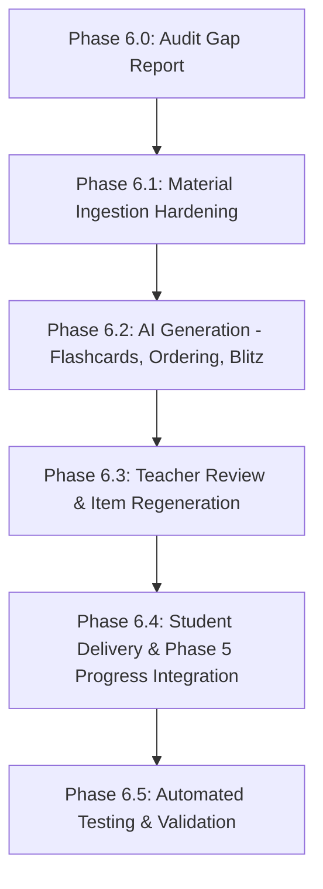

# LUCOUS — PHASE 6 GAP AUDIT: TEACHER CONTENT STUDIO & AI LEARNING CREATION

**Date:** October 12, 2026  
**Repository:** `C:\Users\Shivprasad\Desktop\lucous-website-main`  
**Base Commit:** `ef9588d` (`test(phase-5): add integration and regression coverage`)  
**Active Feature Branch:** `feat/phase-6-teacher-content-studio`  
**Working Tree Status:** Clean  

---

## 1. Executive Summary

Phase 6 aims to complete the **Teacher Content Studio & AI Learning Creation** workflow, enabling approved teachers to:
1. Ingest educational materials (PDF, DOCX, TXT, images) with strict validation and safe storage.
2. Generate source-grounded, curriculum-aligned learning materials, practice tests, flashcards, ordering challenges, and timed quizzes using AI (with transparent preview fallbacks).
3. Review, edit, refine, add/delete, and regenerate learning items before publication.
4. Publish reviewed content with secure access codes (`LU-XXXXXX`).
5. Deliver published materials to students with instant grading, zero answer-key leakage, and direct integration into the Phase 5 persistent progress and XP engine.

An in-depth audit of the repository reveals that significant foundational components exist from earlier phases (e.g. `teacher-materials.js`, `teacher-lessons.js`, `teacher-assessments.js`, `publishing-service.js`, `assessment-editor.tsx`, `published-lesson-viewer.tsx`). However, four specific gaps prevent the end-to-end learning loop from operating seamlessly:
- **Gap 1:** Published assessment completion in the student viewer is decoupled from the Phase 5 progress engine (attempts and XP are not persisted to database).
- **Gap 2:** AI assessment generator lacks explicit support for `FLASHCARD`, `ORDERING`, and `TIMED_BLITZ` formats requested in Phase 6.2.
- **Gap 3:** Teacher review allows only full-assessment regeneration rather than single-item regeneration.
- **Gap 4:** Published content responses lack resolved `topicId`, preventing completed teacher tests from integrating with curriculum topic progress and weak-topic tracking.

---

## 2. Inventory of Existing Functionality

| Component / Subsystem | Status | Files / Endpoints | Test Verification |
| :--- | :--- | :--- | :--- |
| **Teacher Identity & Approval Guard** | **Fully Implemented** | `backend/server.js:requireTeacher` `backend/services/teacher-application-service.js` | Verified (24/24 tests in `test-teacher-approval.js`) |
| **Teacher Dashboard UI** | **Fully Implemented** | `src/components/teacher/teacher-home.tsx` `src/app/(dashboard)/teacher/*` | Rendered with 9 tabs; zero redesign needed |
| **Material Upload & Validation** | **Fully Implemented** | `backend/routes/teacher-materials.js` `backend/services/file-validator.js` | Verified (36/36 tests in `test-teacher-upload.js`) |
| **Storage & Anti-Orphan Rollback** | **Fully Implemented** | `backend/storage/storage-adapter.js` `backend/routes/teacher-materials.js` | Storage rollback on DB failure verified |
| **Document Text Extraction** | **Fully Implemented** | `backend/services/document-processor.js` | Pure-JS extraction for TXT, DOCX, PDF; scanned PDF detection; image OCR honesty |
| **Curriculum Metadata Validation** | **Fully Implemented** | `backend/services/curriculum-validator.js` | Classes 1–12, boards, streams, diploma branches, schemes, semesters 1–8 |
| **AI Lesson Draft Generation** | **Fully Implemented** | `backend/services/lesson-generator.js` `backend/routes/teacher-lessons.js` | Gemini + OpenAI adapters + rule-based preview fallback; verified (26/26 tests in `test-lesson-generation.js`) |
| **AI Assessment Draft Generation** | **Partially Implemented** | `backend/services/assessment-generator.js` `backend/routes/teacher-assessments.js` | Supports MC, TF, Fill-in-Blank, Matching; missing Flashcard, Ordering, Timed Blitz |
| **Teacher Draft Editing & Review** | **Partially Implemented** | `src/components/teacher/assessment-editor.tsx` `src/components/teacher/lesson-draft-editor.tsx` | Full question/option/explanation edits, add/delete; lacks individual item regeneration |
| **Publishing & Access Codes** | **Fully Implemented** | `backend/routes/teacher-publishing.js` `backend/services/publishing-service.js` `backend/services/access-code-service.js` | Unpredictable 8-char `LU-XXXXXX` codes; atomic publish/unpublish; verified (20/20 tests in `test-publishing-and-access.js`) |
| **Student Access Code Delivery** | **Partially Implemented** | `backend/routes/student-access.js` `src/components/student/access-code-form.tsx` `src/components/student/published-lesson-viewer.tsx` | Instant grading per question works; attempt submission and progress persistence missing |
| **Phase 5 Student Progress Engine** | **Fully Implemented** | `backend/server.js:POST /api/student/attempts` `src/components/student/results-view.tsx` | Anti-replay XP, server-side grading, weak topics, retest intelligence; verified (16/16 tests in `test-student-progress-phase5.js`) |

---

## 3. Confirmed Functional Gaps

### Gap 1: Published Assessment Completion Decoupled from Progress Engine
- **Current Behavior:** In `src/components/student/published-lesson-viewer.tsx`, answering all questions displays a celebratory card ("You earned {correctAnswersCount * 10} XP!"), but does not send an attempt payload to the backend.
- **Defect:** No record is created in `Attempt` or `StudentProgress`. The student's XP total is not incremented. The score does not appear in attempt history or the improvement dashboard.
- **Remediation:** Add `POST /api/student/access/submit-attempt` endpoint (or invoke `/api/student/attempts`) that:
  1. Validates the access code and ensures content is PUBLISHED.
  2. Grades the student's submission on the server using verified answer keys.
  3. Enforces Phase 5's anti-replay guard (prevents duplicate submission within 30s from awarding duplicate XP).
  4. Records the attempt with score, correct count, total count, mode (`PRACTICE` or `TEST`), and awards verified XP.
  5. Updates user XP in the database/memory store.
  6. Automatically binds to the Phase 5 progress views.

### Gap 2: Missing Assessment Formats (Flashcards, Ordering Challenges, Timed Blitz)
- **Current Behavior:** `VALID_GAME_FORMATS` in `backend/services/assessment-generator.js` only permits `MULTIPLE_CHOICE`, `TRUE_FALSE`, `FILL_BLANK`, `MATCHING`, `MIXED`. Requesting `FLASHCARD`, `ORDERING`, or `TIMED_BLITZ` throws a 400 parameter validation error.
- **Defect:** Teachers cannot generate flashcards/memory-matching pairs, step-ordering challenges, or timed rapid-fire quizzes grounded in their uploaded materials as required by Phase 6.2.
- **Remediation:**
  1. Add `FLASHCARD`, `ORDERING`, and `TIMED_BLITZ` to `VALID_GAME_FORMATS`.
  2. Implement schema validators:
     - `FLASHCARD`: questions with `front` (term/prompt), `back` (concept/definition), `hint`.
     - `ORDERING`: questions with `items` array with `text` and `correctOrder` sequence.
     - `TIMED_BLITZ`: rapid multiple-choice questions with `timeLimitSeconds` (e.g. 15s).
  3. Update AI system prompt and deterministic unconfigured preview generator.
  4. Expose these formats in `AssessmentsPanel` format dropdown.

### Gap 3: Missing Individual Item Regeneration
- **Current Behavior:** In `src/components/teacher/assessment-editor.tsx`, clicking "Regenerate" regenerates the *entire* assessment from the source document, overwriting all existing question edits.
- **Defect:** A teacher who likes 4 out of 5 questions cannot regenerate only the 1 unsuitable question.
- **Remediation:**
  1. Add `POST /api/teacher/assessments/:id/regenerate-item` or client-side single item regeneration handler.
  2. Allow teacher to click "Regenerate This Question" on any individual item card.

### Gap 4: Missing `topicId` in Published Content Delivery
- **Current Behavior:** `getStudentContentByAccessCode` in `backend/services/publishing-service.js` returns metadata fields `subject`, `chapter`, `topic` as string labels, but omits `topicId`.
- **Defect:** When a student submits an attempt from a published assessment, the attempt cannot associate with the curriculum topic node in `prisma.attempt.topicId`, breaking weak-topic detection and subject-level mastery calculations.
- **Remediation:**
  1. Update `AssessmentDraft` model/record creation to store `topicId` (retrieved from `UploadedMaterial.topicId` or matched via curriculum service).
  2. Include `topicId` in sanitized student access payloads.

---

## 4. Security & Authorization Analysis

1. **Teacher Application Guard (`requireTeacher`):**
   - Verified: Non-approved teachers (PENDING or REJECTED) are blocked with 403 status across all `/api/teacher/*` endpoints.
   - Admin review requirements remain strictly enforced.
2. **Cross-Teacher Isolation:**
   - Verified: Materials, lesson drafts, and assessments filter by `teacherId === req.userId`. Access attempts by other teachers yield 404 Not Found or 403 Forbidden.
3. **Student Content Confidentiality:**
   - Verified: Raw answer keys and private teacher metadata are omitted from `POST /api/student/access/verify`. Drafts and unpublished materials are completely invisible to students (returns 404).
4. **Anti-Replay & XP Exploit Defense:**
   - Attempt submissions must apply the 30-second rapid submission throttle and answer deduplication by `questionId` to prevent fraudulent XP inflation.
5. **Access Code Brute-Force Protection:**
   - Verified: `checkRateLimit` enforces a maximum of 40 verification attempts per 5 minutes per IP address.

---

## 5. Implementation Roadmap (Smallest Viable Enhancements)

1. **Stage 6.1 (Ingestion Hardening):** Verify MIME types, signature detection, anti-orphan rollbacks, and OCR honesty across all supported formats.
2. **Stage 6.2 (AI Content Generation):** Extend `assessment-generator.js` with `FLASHCARD`, `ORDERING`, and `TIMED_BLITZ` formats with full schema validation and preview fallbacks.
3. **Stage 6.3 (Teacher Review & Publishing):** Add individual question regeneration in `assessment-editor.tsx` and ensure `topicId` is preserved on drafts and published items.
4. **Stage 6.4 (Student Delivery & Progress Engine):** Implement authenticated attempt submission for published assessments (`POST /api/student/access/submit-attempt`), linking student scores directly to Phase 5's `Attempt`, `StudentProgress`, and XP accumulation.
5. **Stage 6.5 (Verification Suite):** Add comprehensive automated test suite (`backend/test-teacher-content-studio-phase6.js`) verifying all ingestion, generation, review, publishing, access-code, progress integration, and security guardrails.
